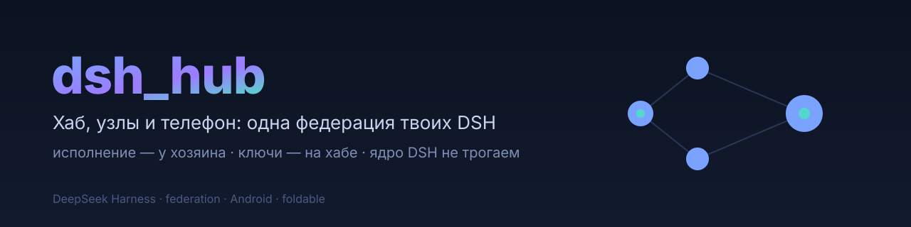
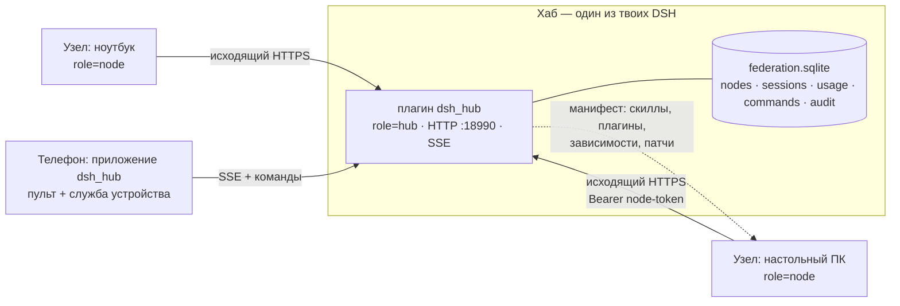
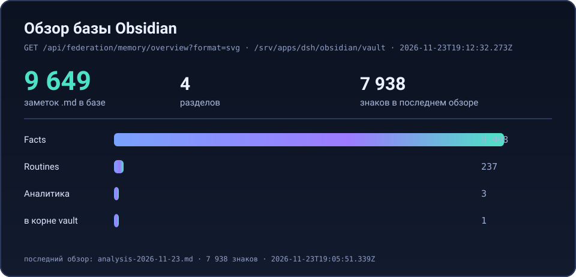
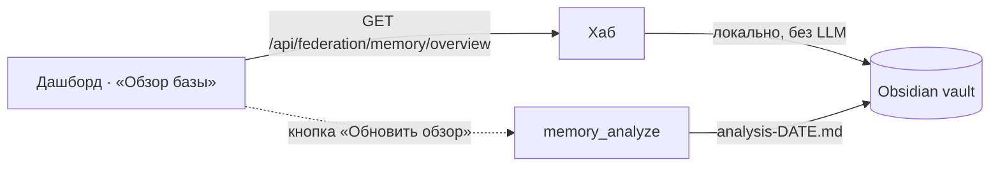

<p align="center"></p>

<h1 align="center">dsh_hub</h1>

<p align="center"><b>Одно окно на все твои DeepSeek Harness: хаб, узлы и телефон.</b></p>

<p align="center">
  
  
  
  
  
</p>

**RU** · [English](#english)

| Раздел | Что внутри |
| --- | --- |
| 🎯 [О проекте](#о-проекте) | Зачем нужна федерация из своих устройств |
| 🧭 [Принципы](#принципы) | Три правила, из которых выведено всё остальное |
| 🏗️ [Как устроено](#как-устроено) | Хаб, узлы, телефон, протокол |
| ✅ [Что уже работает](#что-уже-работает) | Хаб v0 и его проверки |
| 🧠 [Память и дашборд](#память-и-дашборд) | Один общий RAG и обзор базы Obsidian на панели |
| 🗺️ [План](#план) | Этапы, объём, приёмка |
| 📱 [Телефон и раскладные экраны](#телефон-и-раскладные-экраны) | Песочница, assist, полный доступ; FCP-N49 |
| ⚡ [Быстрый старт](#быстрый-старт) | Поднять хаб и прогнать тесты |
| 📚 [Документы](#документы) | План, приложение, протокол |

---

## О проекте

Один ноутбук, один настольный ПК, один телефон — и на каждом свой DeepSeek Harness со своими сессиями.
Хочется одного: видеть их из одного окна, отправлять промпты в чужую сессию, держать ключи LLM в одном
месте и не терять работу, когда устройство выключено.

`dsh_hub` — это **федерация**: один экземпляр DSH становится хабом, остальные — узлами. Узлы живут своей
жизнью (свои сессии, своя работа, свой офлайн), хаб видит всё, собирает общую память, хранит единственные
ключи моделей и даёт одно окно управления — на ПК и в Android-приложении.

Проект сознательно не трогает ядро DSH: всё живёт плагинами профиля и файлами состояния, поэтому
обновление DSH не превращается в починку федерации.

## Принципы

1. **Исполнение — только у хозяина.** Сессия живёт и исполняется на устройстве, где создана. Хаб управляет,
   но не исполняет чужие ходы: промпт из окна хаба доезжает до узла и исполняется там.
2. **Хаб — единственная точка прав и ключей.** Модели, allowlist, видимость сессий, статистика расходов —
   на хабе. Узлам не нужны свои ключи LLM, а если ключ пропал — запрос падает, а не уходит «куда-нибудь».
3. **Ядро DSH не трогаем.** Плагины профиля, файлы состояния, никаких форков ядра.
4. **Телефон — такой же узел, только с руками.** Приложение умеет управлять своим устройством в одном из
   трёх режимов: `sandbox` (по умолчанию), `assist` (служба доступности), `full` (Shizuku, права shell).
5. **Опасное — по подтверждению.** Инструменты уровня `phone_shell` по умолчанию спрашивают разрешение,
   каждое решение пишется в аудит, «стоп» гасит команды.
6. **Автоматизация — одна на всех.** Скиллы, плагины, зависимости и патчи собираются в профиле хаба и
   раскатываются на узлы контентно-адресным манифестом: узел не заводит свой набор, а догоняет хаб и
   показывает дрейф.

## Как устроено



Ключевые части:

- **хаб** — HTTP + SSE на локальном порту, SQLite, снапшоты сессий, очередь команд, аудит;
- **узел** — плагин в профиле DSH: спаривание, отправка `index`, приём команд, исполнение у себя;
- **телефон** — нативное приложение (Kotlin + Compose): пульт и, при разрешении, руки;
- **протокол** — `proto: 1`, идемпотентные `commandId`, курсоры `Last-Event-ID` на обоих SSE.

Подробности: [протокол и модель данных](docs/FEDERATION.md).

## Что уже работает

Живая федерация, а не макет: хаб-служба на настольном ПК (`0.0.0.0:18990`), узел на втором ПК, общий RAG
и два телефона. Каждый пункт ниже — с цифрой и способом проверки.

| Что | Итог | Чем доказано |
| --- | --- | --- |
| **Хаб v1** | служба `dsh-hub`, SQLite, очередь команд с идемпотентным `commandId`, SSE-поток узлу с курсором, снапшоты, `usage`, аудит, дашборд на `/` | `npm test` **9/9**, `GET /healthz` → `{"ok":true,"proto":1}` |
| **Узел** | плагин `@local/dsh-hub-node` на Debian-ПК: `hello`, `index`, сессия создана **из хаба**, `prompt` исполнен **на узле** | тесты **2/2**; в журнале узла `turn/end`, в хабе — `reply{accepted}` и снапшот переписки |
| **Память** | 374 журнала Windows-ПК влиты в **тот же** `ctxdb.sqlite` | 48 168 чанков отправлено → **21 469 новых** (14 проектов), 29 099 дублей отсеклось по id; поиск по фразе из Windows-сессии отдаёт её первой |
| **Автоматизация (P2d)** | манифест профиля хаба: **856 скиллов + 3 чек-скрипта**, `sha` на весь набор, выдача файлов по одному, применение командой `automation.apply` | на узле 859 файлов, `sha` совпал, состояние `in-sync`; удалённый скилл вернулся следующим `apply` |
| **Телефоны** | Redmi 23122PCD1G и HONOR FCP-N49 видят хаб **по локальной сети** (`192.168.88.35:18990`), без `adb reverse` | на обоих `ru.dsh.hub` показывает узел `debian17`; на Redmi открыты его 2 сессии и переписка (4 сообщения) |

```text
$ cd hub && npm test
ℹ tests 9 · pass 9 · fail 0     # хаб: спаривание, SSE-очередь, офлайн-курсор, снапшоты, usage, аудит
$ cd node && npm test
ℹ tests 2 · pass 2 · fail 0     # узел: index, prompt у себя, снапшот переписки
```

Правило версий: контракт `sessionController` у DSH 0.2.1-rc.2 и 0.2.2-rc.5 разный (нет `state`/`wait`,
`page()` требует `throughSeq`, сообщение лежит то в `data.message`, то прямо в `data`) — узел пробует формы
по очереди и запоминает **вид** запроса, а не адрес, иначе снапшот одной сессии уезжает в другую.

**Честная оговорка:** ход на узле доходит до модели только при живом лимите провайдера. На стенде он
упёрся в недельный лимит Z.AI (429 `Weekly/Monthly Limit Exhausted` до 2026-11-25) — транспорт, очередь и
исполнение проверены, ответ модели ждёт восстановления квоты. Структурное лечение — прокси моделей на хабе
(P3a), чтобы у узла и телефона вообще не было своих ключей.

## План

| Этап | Что получаем | Время |
| --- | --- | --- |
| P0-«-1» Врата | 6 инвариантов парами «плохо/хорошо», контрактный чек, канареечный узел | 2 дня |
| P0 Память | спул + приём + бэкфилл → **один общий RAG** (LightRAG), метка `workspace`/`node` | 2 дня |
| P1 Узел | спаривание, токен, `index/snapshot/usage/memory`, SSE-клиент, адаптер моделей | 4–5 дней |
| P2 Хаб + UI | SQLite, снапшоты, приём, SSE наружу, панель | 5–6 дней |
| P2b Клиент Android | приложение: узлы, сессии, переписка, промпт, approvals | 5–6 дней |
| P2c Телефон как узел | служба устройства: sandbox / assist / full, `phone_*`, аудит | 3–4 недели |
| P2d Автоматизация узлов | манифест профиля хаба: скиллы, `@local/*`, патчи, MCP, дрейф, откат | 2–3 дня |
| P3 Исполнение | prompt/cancel/rename, очередь, TTL, approvals-релей | 3–4 дня |
| P3a Права и модели | видимость, allowlist, прокси «единственные ворота», отзыв | 3–4 дня |
| P3b Статистика | `usage`, агрегаты, карточки, граф памяти | 2 дня |
| P4 Полировка | второй узел, офлайн-очередь, доки, чек-скрипт | 2–3 дня |

MVP (P0–P2) — около полутора недель, полный объём с телефоном — 7–8 недель агентской работы.
Этапы, критерии приёмки и риски — в [docs/PLAN.md](docs/PLAN.md).

## Память и дашборд

Память у федерации **одна на всех**: хаб уже держит `dsh-memory-hub` (ингест `session/event` всех чатов и
воркспейсов, гибридный поиск, дедуп по `hash`) и LightRAG на `127.0.0.1:9621`. Узел присылает чанки в
`POST /fed/v1/memory`, и они ложатся **в тот же индекс** с меткой `workspace`/`node` — вопрос задаётся один
раз, а не трижды по числу устройств.

Дашборд хаба показывает состояние базы не «на глаз», а конкретными числами и последним обзором. Панель
«Обзор базы» берёт готовую заметку `Аналитика/analysis-YYYY-MM-DD.md`, которую пишет `memory_analyze`, и
считает заметки по разделам — всё локально, без вызова модели. Новый анализ — по кнопке.





- Ответ панели: заметки по разделам, объём последнего обзора, `updated_at`, полный текст обзора.
- **Два режима одного расчёта.** `?format=svg` отдаёт ту же картину вектором (3,5 КБ на 9 649 заметок):
  масштабируется без потерь, годится для панели, GitHub и телеграма. Файл
  `assets/vault-overview.svg` в репозитории — вывод `--overview-svg` по живой базе, а не рисунок руками.
- Vault не смонтирован → `available:false`, `reason:"vault-missing"`; панель пишет «база недоступна», а не
  пустой экран и не `500`.
- Скрытая сессия в индекс не попадает, поэтому её нет и в обзоре — правило видимости одно на все пути.

## Телефон и раскладные экраны

Приложение рассчитано на три раскладки и не ломается при сгибе:

| Устройство | Ширина окна | Раскладка |
| --- | --- | --- |
| Телефон (сложен) | ~353 dp | одна колонка: список → сессия → чат по шагам |
| Раскладной (раскрыт) | ~718 dp | две колонки: слева узлы и сессии, справа переписка |
| Планшет / веб | ≥ 840 dp | три зоны: узлы, сессии, чат |

Сгиб определяется через `WindowInfoTracker` + `FoldingFeature`: `HALF_OPENED` с вертикальной складкой —
контент раскладывается по половинам и не заезжает на петлю; горизонтальная складка — верх/низ.
Состояние экрана и черновик промпта переживают сгиб и разгиб (`rememberSaveable`, `ViewModel`).

Проверено на живом устройстве: **HONOR FCP-N49**, Android 17 (API 37), два дисплея — внутренний
2156×2344 (480 dpi, ~718 dp) и внешний 1060×2376 (~353 dp). Как устроены режимы `sandbox` / `assist` / `full`
и как это принимается на телефоне — в [docs/APP.md](docs/APP.md).

## Быстрый старт

```bash
cd hub
npm test                                   # 9/9 pass
node src/hub.mjs --port 18990 --code ABCD --db ~/.dsh/federation.sqlite \
  --vault /srv/apps/dsh/obsidian/vault
```

```bash
# обзор базы: JSON для панели, тот же расчёт картинкой и файлом
curl -s 'localhost:18990/api/federation/memory/overview'
curl -s 'localhost:18990/api/federation/memory/overview?format=svg' > vault.svg
node src/hub.mjs --vault /srv/apps/dsh/obsidian/vault --overview-svg assets/vault-overview.svg
```

```bash
# спаривание узла
curl -s localhost:18990/fed/v1/pair -H 'content-type: application/json' \
  -d '{"code":"ABCD","node":{"name":"desktop","os":"linux"}}'
# → {"ok":true,"nodeId":"node_…","token":"…"}
```

## Документы

- [docs/PLAN.md](docs/PLAN.md) — этапы, критерии приёмки, риски.
- [docs/APP.md](docs/APP.md) — приложение: экраны, режимы доступа, раскладные экраны, приёмка.
- [docs/FEDERATION.md](docs/FEDERATION.md) — протокол, модель данных, безопасность.

---

## English

<p align="center"><b>One window for all your DeepSeek Harnesses: hub, nodes and phone.</b></p>

**One machine becomes the hub, the rest become nodes.** Each node keeps its own sessions, its own work and its
own offline mode. The hub sees everything, collects shared memory, holds the only LLM keys and gives one
control window — on the desktop and in an Android app.

### Principles

1. **Execution stays with the owner.** A session lives and runs on the device where it was created; the hub
   commands, it never runs somebody else's turn.
2. **The hub is the single point of rights and keys.** Models, allowlists, visibility, spend statistics — on
   the hub. Nodes need no keys of their own; a missing key fails the request instead of routing it elsewhere.
3. **The DSH core is untouched.** Profile plugins and state files only.
4. **The phone is a node with hands.** `sandbox` (default), `assist` (accessibility service) and `full`
   (Shizuku, shell rights) — the device decides, the agent only asks.
5. **Dangerous tools ask.** `phone_shell` requires confirmation by default, every decision goes to the audit
   log, and a stop switch halts commands.
6. **Automation is shared, not per device.** Skills, plugins, dependencies and kernel patches live in the hub
   profile and roll out as a content-addressed manifest; a node catches up and reports drift instead of
   growing its own set.

### Status

A live federation, not a mock-up: the hub service on a desktop PC (`0.0.0.0:18990`), a node on a second PC,
one shared RAG and two phones — each item below carries a number and a way to check it.

| Piece | Result | Evidence |
| --- | --- | --- |
| **Hub v1** | `dsh-hub` service, SQLite, idempotent `commandId` queue, SSE stream with a cursor, snapshots, `usage`, audit, dashboard at `/` | `npm test` **9/9**, `GET /healthz` → `{"ok":true,"proto":1}` |
| **Node** | `@local/dsh-hub-node` plugin on a Debian PC: `hello`, `index`, a session created **from the hub**, a `prompt` executed **on the node** | tests **2/2**; `turn/end` in the node's journal, `reply{accepted}` plus a chat snapshot in the hub |
| **Memory** | 374 journals from a Windows PC merged into the **same** `ctxdb.sqlite` | 48,168 chunks sent → **21,469 new** (14 projects), 29,099 duplicates dropped by id; a phrase from a Windows session ranks its session first |
| **Automation (P2d)** | the hub profile manifest: **856 skills + 3 check scripts**, one `sha` for the set, files served one by one, applied by `automation.apply` | 859 files on the node, matching `sha`, state `in-sync`; a deleted skill came back on the next `apply` |
| **Phones** | Redmi 23122PCD1G and HONOR FCP-N49 reach the hub **over LAN** (`192.168.88.35:18990`), no `adb reverse` | both show node `debian17`; the Redmi lists its 2 sessions and reads the conversation (4 messages) |

**Honest caveat:** a node turn only reaches the model while the provider quota is alive. On this stand it hit
Z.AI's weekly limit (429 `Weekly/Monthly Limit Exhausted` until 2026-11-25) — transport, queue and execution
are verified, the model answer waits for the quota. The structural fix is a model proxy on the hub (P3a), so
neither a node nor a phone needs a key of its own.

### Memory and dashboard

Memory is one shared RAG for the whole federation: the hub runs `dsh-memory-hub` (ingests `session/event`
from every chat and workspace, hybrid recall, hash dedupe) plus LightRAG on `127.0.0.1:9621`. A node posts
chunks to `POST /fed/v1/memory` and they land in the **same** index tagged with `workspace`/`node` — one
question, one answer, not one per device.

The dashboard shows the base as numbers, not vibes. The "Base overview" panel reads the latest
`Аналитика/analysis-*.md` written by `memory_analyze`, counts notes per section locally (no LLM call on open),
and offers an explicit refresh button. A missing vault answers `available:false` with `reason:"vault-missing"`
instead of a blank screen or a 500. The same computation also renders as SVG (`?format=svg`, ~3.5 KB for
9,649 notes) so the panel, GitHub and Telegram get a lossless picture; the committed
`assets/vault-overview.svg` is CLI output over the live vault, not a hand drawing. Hidden sessions are
never ingested, so they are absent from the overview too — one visibility rule for every read path.

### Foldables

The Android app ships three layouts: compact single column (~353 dp folded), two-pane list/detail (~718 dp
unfolded) and three zones on tablets. Posture comes from `WindowInfoTracker` + `FoldingFeature`; state and
prompt drafts survive folding and unfolding. Verified on HONOR FCP-N49, Android 17 (API 37), dual display
2156×2344 inner / 1060×2376 outer. See [docs/APP.md](docs/APP.md).

### Quick start

```bash
cd hub && npm test
node src/hub.mjs --port 18990 --code ABCD --db ~/.dsh/federation.sqlite
```

### Docs

[docs/PLAN.md](docs/PLAN.md) · [docs/APP.md](docs/APP.md) · [docs/FEDERATION.md](docs/FEDERATION.md)

---

`#deepseek-harness` `#dsh` `#federation` `#self-hosted` `#android` `#kotlin` `#foldable` `#sse` `#sqlite`
