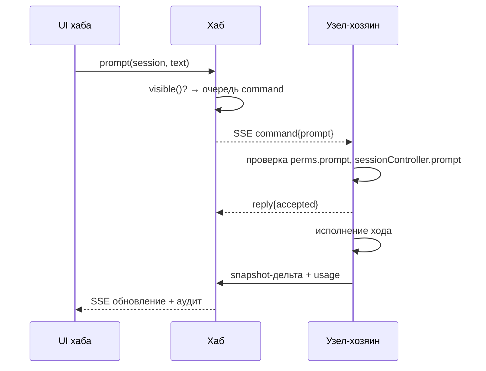

# Федерация: роли, протокол, данные, безопасность

Дата: 2026-11-23 · Все изменения — плагины профиля DSH и файлы состояния; ядро не форкается.

## 1. Роли

| Роль | Кто | Что делает |
| --- | --- | --- |
| `hub` | один экземпляр DSH (обычно настольный ПК) | хранит узлы, сессии, права, usage, команды, аудит; держит ключи LLM; отдаёт UI |
| `node` | остальные DSH и приложение на телефоне | исполняет свои ходы, отдаёт `index`/`snapshot`/`usage`/`memory`, принимает команды |
| `viewer` | UI хаба | смотрит и командует в пределах прав видимости |

Правило исполнения: **шаг исполняется только на узле-хозяине**. Хаб не подменяет узел и не исполняет
чужие ходы — он может лишь поставить команду в очередь.

## 2. Протокол (v1)

| Направление | Роут | Формат |
| --- | --- | --- |
| узел → хаб | `POST /fed/v1/pair` | `{code, node:{name, version, os, host}}` → `{nodeId, token}` |
| узел → хаб | `POST /fed/v1/hello` | `{proto:1, node, capabilities, models_seen}` → `{proto:1, allowlist}` |
| узел → хаб | `POST /fed/v1/index` | `{sessions:[{id, title, cwd, status, updated_at, turns, size}]}` |
| узел → хаб | `POST /fed/v1/snapshot` | `{sessionId, upToSeq, messages[]}` (gzip) |
| узел → хаб | `POST /fed/v1/usage` | пачка вызовов: модель, токены, статус, ms, `request_id` |
| узел → хаб | `POST /fed/v1/memory` | пачка чанков: kind, project, session, hash, text |
| узел → хаб | `GET /fed/v1/stream?cursor=N` | SSE: `command`, `node-refresh`; `Last-Event-ID` |
| узел → хаб | `POST /fed/v1/reply` | `{commandId, ok, result}` — идемпотентно |
| UI → хаб | `GET /api/federation/nodes|sessions|session/:id|stats|audit` | JSON |
| UI → хаб | `POST /api/federation/prompt|cancel|rename|perms` | JSON → `commandId` |
| LLM узла → хаб | `POST /fed/v1/llm/stream` | стрим, `model` сверяется с allowlist узла |

Правила:

- `proto` проверяется в `hello`; неизвестная версия — отказ, а не «попробуем».
- `commandId` и `request_id` идемпотентны: повтор не исполняется дважды.
- Курсор события — `(session_id, seq)`; оба SSE используют `Last-Event-ID`; при разрыве узел
  переподключается с последнего курсора, хаб реплеит неотданное из БД.
- Пачки не дольше ~55 с; что не влезло — следующей пачкой.

## 3. Главный сценарий



Если узел офлайн — команда ждёт до TTL, потом `expired` в аудит. Хаб никогда не делает шаг «исполнение».

## 4. Телефон как узел

Телефон — узел с расширенными `capabilities`. В `hello` он сразу говорит, что умеет:

```json
{
  "proto": 1,
  "node": { "name": "phone-fcp", "version": "0.1.0", "os": "android-17" },
  "capabilities": {
    "modes": ["sandbox", "assist"],
    "tools": ["phone_ui_tree", "phone_screenshot", "phone_tap", "phone_type", "phone_open_app"],
    "full": false
  }
}
```

Команда того же вида, что `prompt`, только `kind: "device.tool"`:

```json
{ "commandId": "c-7f1a", "kind": "device.tool",
  "payload": { "tool": "phone_tap", "args": { "x": 540, "y": 1200 } } }
```

| Инструмент | Минимальный режим | Что возвращает |
| --- | --- | --- |
| `phone_ui_tree` | assist | элементы: role, text, bounds, clickable |
| `phone_screenshot` | assist | PNG (base64), размеры экрана |
| `phone_tap` / `phone_swipe` | assist | `ok` или `unsupported-surface` |
| `phone_type` | assist | `ok`, фактический текст поля |
| `phone_open_app` | assist | `ok`, пакет и активность |
| `phone_notifications` | assist | список: пакет, заголовок, текст |
| `phone_clipboard_get/set` | full | текст |
| `phone_shell` | full | stdout/stderr, код возврата, лимит вывода |

Ошибки — отдельными кодами, без подмены: `no-permission` (режим не включает инструмент),
`needs-confirmation` (политика `ask`), `unsupported-surface` (защищённый экран), `full-unavailable`
(Shizuku не запущен), `timeout`. Агент должен видеть причину, а не «не получилось».

## 5. Модель данных (хаб)

```sql
nodes(id, name, mode, token_hash, version, os, host, last_seen, created_at, perms_json, visibility_json)
node_models(node, provider, model, priority, enabled, max_budget, budget_duration, rpm, tpm)
sessions(id, node, owner_node, title, cwd, status, updated_at, turns, size, snapshot_at, snapshot_z, seq)
usage(id, request_id, upstream_request_id, node, provider, model, ts,
      in_tokens, out_tokens, cache_read, cost_usd, status, ms, retry)
usage_daily(node, day, model, requests, in_tokens, out_tokens, cost_usd, errors)
memory_ingest(node, day, chunks, bytes, dupes)
commands(id, node, kind, payload_json, created_at, expires_at, state, result_json)
pairing(code_hash, node_name, created_at, expires_at, approved, used_at)
audit(id, ts, viewer, node, action, session, result, detail_json)
```

Правила: деньги — `TEXT` с Decimal, ни одного `float`; `cost_usd = null`, если цены модели нет;
`state` команды ∈ `queued|delivered|done|failed|expired`; `mode` узла ∈ `full|readonly|quarantine`.

## 6. Память: один общий RAG

RAG федерации **не строится заново и не размножается по узлам**. На хабе уже работает общая память —
`dsh-memory-hub` (ингест `session/event` всех чатов и воркспейсов, гибридный recall, дедуп по `hash`) и
LightRAG 1.5.7 на `127.0.0.1:9621`. Узел присылает чанки в `POST /fed/v1/memory`, хаб кладёт их **в тот же
индекс**, что и собственные сессии.

- **Пометка, не копия.** Чанк несёт `workspace` (воркспейс на узле) и `node`; поиск по умолчанию сквозной
  (`lightragCrossWorkspace`), сужение — фильтром по метке. Второго RAG на узел нет: иначе один и тот же
  вопрос пришлось бы задавать трижды и получать три разных ответа.
- **Скрытая сессия не индексируется.** Нет записи в индексе — нет находки и в поиске памяти, а не «есть, но
  прячется в UI». Правило видимости проверяется на входе в ингест.
- **`memory_ingest` — счётчик, не база.** Чанки/байты/дубли на узел в сутки: по нему видно отставание
  бэкфилла, а не «всё хорошо».
- **Obsidian — представление того же индекса**, а не отдельное хранилище: расхождение возможно только по
  времени выгрузки.
- **Бэкфилл безопасен:** повторная отправка идемпотентна по `hash`, старые сессии догоняются тем же роутом.

## 7. Безопасность

- **Токены.** Узлу выдаётся случайный токен при спаривании; на хабе хранится только `sha256`. Отзыв —
  удаление строки, узел получает `401` на следующем запросе.
- **Спаривание.** Одноразовый код с TTL, вводится руками на узле; повторное использование — отказ.
- **Видимость.** Скрытая сессия не отдаётся списком, поиском памяти и прямым id (`404`), а не «не
  показывается в UI».
- **Аудит.** Каждая команда и каждое подтверждение — строка в `audit`: кто, что, где, чем кончилось.
- **Прокси моделей — единственные ворота.** Allowlist узла, бюджет, RPM/TPM проверяются до апстрима;
  отказ `403` с отдельным кодом, без тихой подмены модели. `fallback` резолвится на загрузке конфига.
- **Счёт.** `user` в запросе к провайдеру = `sha256(token)` узла, чтобы провайдерский счёт сходился с нашим.
- **Данные не уезжают.** Личная федерация — только свои устройства; трансграничная передача не
  предусмотрена. Если когда-нибудь появится внешний арендатор — это отдельный контур и отдельные правила.

## 8. Версии и совместимость

- `proto: 1` в `hello`; неизвестная версия — отказ с текстом, а не молчаливое угадывание.
- Версия DSH пиннится на хабе и узлах (`engines.dsh`), канареечный узел проверяет контракт до раскатки.
- Контрактный чек сверяет методы и события `sessionController` — то, что реально используется, а не «сервисы
  живы».

## English

Three roles — hub, node and viewer — with one hard rule: a turn runs only on the node that owns the session.
The protocol is versioned (`proto: 1`), idempotent by `commandId`, and both SSE directions resume from
`Last-Event-ID`. The phone joins as a node with extended capabilities and receives `device.tool` commands for
`phone_ui_tree`, `phone_screenshot`, `phone_tap`, `phone_type`, `phone_open_app`, clipboard and shell, each
gated by an access mode (`sandbox`, `assist`, `full`) and a per-tool policy. Failures have distinct codes
(`no-permission`, `needs-confirmation`, `unsupported-surface`, `full-unavailable`, `timeout`) so the agent sees
the reason instead of a silent miss. Security: hashed node tokens, one-time pairing codes, visibility enforced
in every read path, full audit, and a model proxy that is the single gate for allowlists, budgets and rate
limits. Money is stored as decimal text, never float; a missing price yields `cost_usd = null`.

Memory stays one shared RAG, not one per node: the hub already runs `dsh-memory-hub` (ingests
`session/event` from every chat and workspace, hash-deduped hybrid recall) plus LightRAG 1.5.7 on
`127.0.0.1:9621`. A node posts chunks to `POST /fed/v1/memory` and the hub writes them into the **same**
index, tagged with `workspace` and `node`, so a fact is found by one search instead of three. A hidden
session is never ingested, so it cannot be found either; `memory_ingest` counts chunks/bytes/dupes per node
per day to expose backfill lag, and Obsidian is a view of that index, not a second store.
