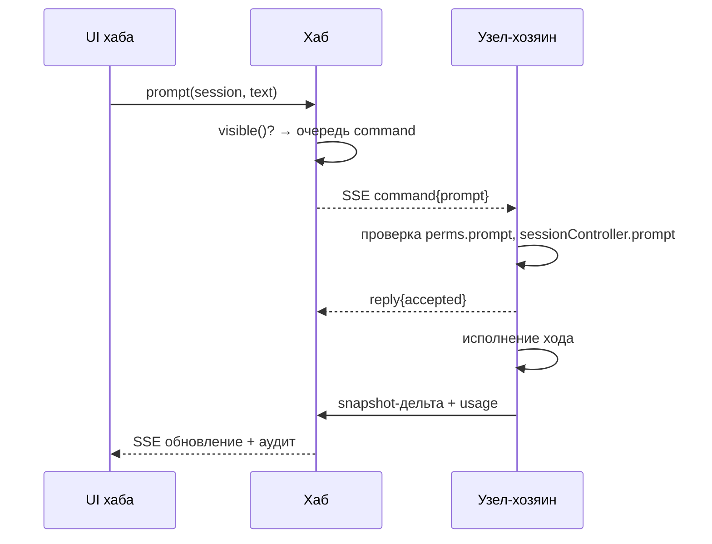
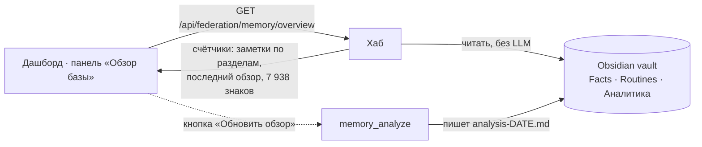
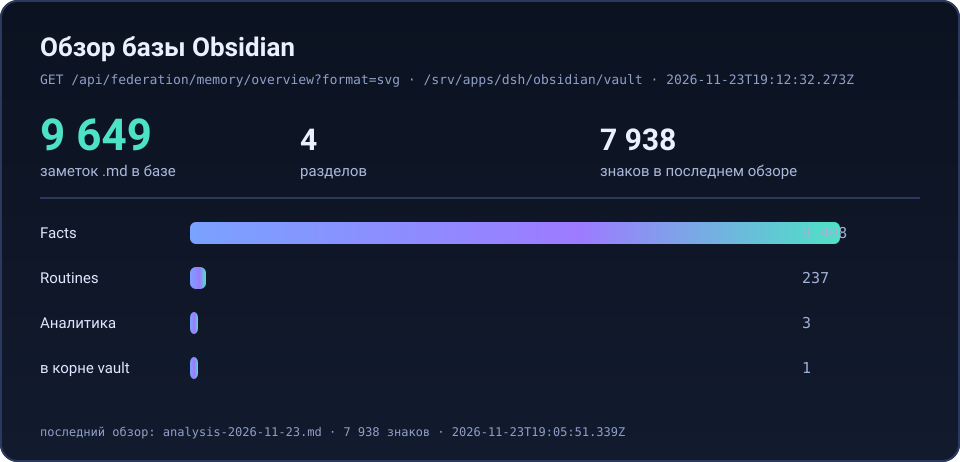
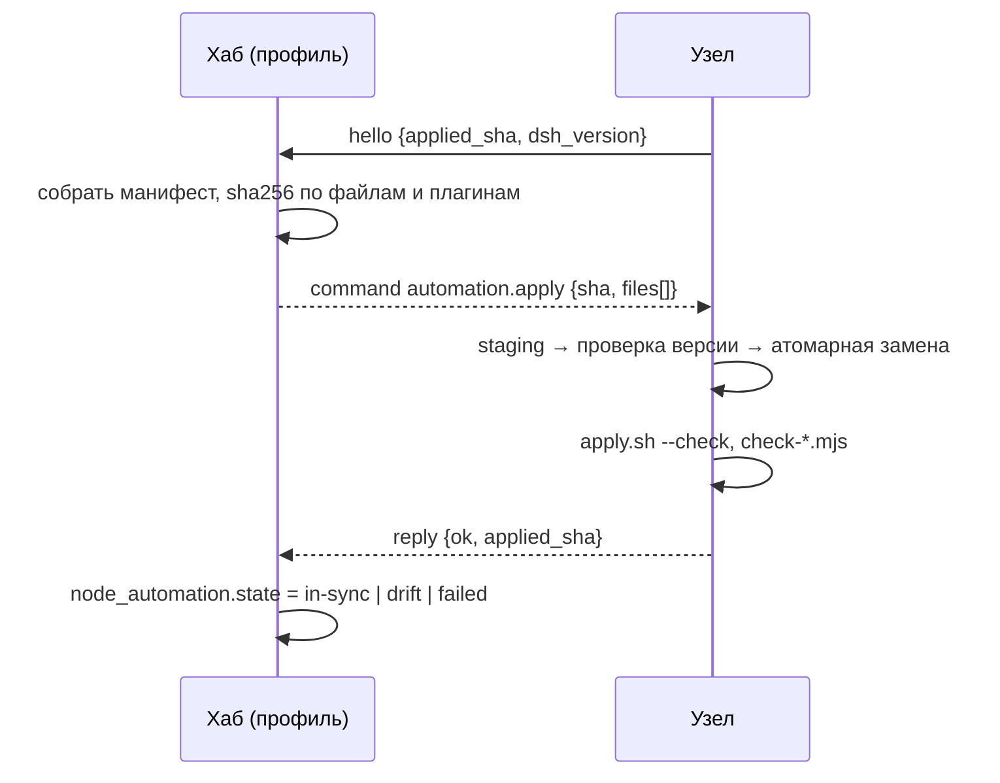

# Федерация: роли, протокол, данные, безопасность

Дата: 2026-11-23 · Все изменения — плагины профиля DSH и файлы состояния; ядро не форкается.

## 1. Роли

| Роль | Кто | Что делает |
| --- | --- | --- |
| `hub` | один экземпляр DSH (обычно настольный ПК) | хранит узлы, сессии, права, usage, команды, аудит; держит ключи LLM; отдаёт UI |
| `node` | остальные DSH и приложение на телефоне | исполняет свои ходы, отдаёт `index`/`snapshot`/`usage`/`memory`, принимает команды |
| `viewer` | UI хаба | смотрит и командует в пределах прав видимости |

Правило исполнения: **шаг исполняется только на узле-хозяине**. Хаб не подменяет узел и не исполняет
чужие ходы — он может лишь поставить команду в очередь.

## 2. Протокол (v1)

| Направление | Роут | Формат |
| --- | --- | --- |
| узел → хаб | `POST /fed/v1/pair` | `{code, node:{name, version, os, host}}` → `{nodeId, token}` |
| узел → хаб | `POST /fed/v1/hello` | `{proto:1, node, capabilities, models_seen}` → `{proto:1, allowlist}` |
| узел → хаб | `POST /fed/v1/index` | `{sessions:[{id, title, cwd, status, updated_at, turns, size}]}` |
| узел → хаб | `POST /fed/v1/snapshot` | `{sessionId, upToSeq, messages[]}` (gzip) |
| узел → хаб | `POST /fed/v1/usage` | пачка вызовов: модель, токены, статус, ms, `request_id` |
| узел → хаб | `POST /fed/v1/memory` | пачка чанков: kind, project, session, hash, text |
| узел → хаб | `POST /fed/v1/automation/report` | `{applied_sha, dsh_version, plugins[], skills[], patches[], errors[]}` — что реально стоит |
| узел → хаб | `GET /fed/v1/automation/manifest[?since=<sha>]` | `{sha, dsh_version, files[{kind,path,mode,sha256}], plugins[]}`; тот же `sha` — `304` |
| узел → хаб | `GET /fed/v1/stream?cursor=N` | SSE: `command`, `node-refresh`; `Last-Event-ID` |
| узел → хаб | `POST /fed/v1/reply` | `{commandId, ok, result}` — идемпотентно |
| UI → хаб | `GET /api/federation/nodes\|sessions\|session/:id\|stats\|audit` | JSON |
| UI → хаб | `GET /api/federation/memory/overview[?format=svg]` | JSON: заметки по разделам + последний обзор `Аналитика/analysis-*.md`; `format=svg` — та же картинка (`image/svg+xml`) |
| UI → хаб | `POST /api/federation/prompt\|cancel\|rename\|create` | JSON → `commandId` (модель в `prompt.model`) |
| UI → хаб | `GET /api/federation/command?id=` | состояние команды и её результат (для `create` — `sessionId`) |
| UI → хаб | `POST /api/federation/automation/apply` | `{node}` → `commandId`; `GET /api/federation/automation` — манифест и состояние узлов |
| LLM узла → хаб | `POST /fed/v1/llm/stream` | стрим, `model` сверяется с allowlist узла |

Правила:

- `proto` проверяется в `hello`; неизвестная версия — отказ, а не «попробуем».
- `commandId` и `request_id` идемпотентны: повтор не исполняется дважды.
- Курсор события — `(session_id, seq)`; оба SSE используют `Last-Event-ID`; при разрыве узел
  переподключается с последнего курсора, хаб реплеит неотданное из БД.
- Пачки не дольше ~55 с; что не влезло — следующей пачкой.

## 3. Главный сценарий



Если узел офлайн — команда ждёт до TTL, потом `expired` в аудит. Хаб никогда не делает шаг «исполнение».

## 4. Телефон как узел

Телефон — узел с расширенными возможностями. У него нет профиля DSH, поэтому канал свой, но правила те
же: агент не получает прав устройства, он присылает запрос, а приложение проверяет режим и политику.

**Регистрация.** Приложение зовёт `POST /fed/v1/device/hello` с токеном хаба один раз, получает
`deviceId` и собственный `deviceToken` (на хабе только `sha256`), дальше ходит им. В `hello` оно сразу
говорит, что умеет:

```json
{ "proto": 1,
  "device": { "name": "HONOR FCP-N49", "model": "FCP-N49", "android": "17", "sdk": 37 },
  "mode": "assist",
  "capabilities": { "modes": ["sandbox", "assist", "full"],
                    "tools": ["phone_ui_tree", "phone_screenshot", "phone_tap", "phone_swipe",
                              "phone_type", "phone_open_app", "phone_shell"],
                    "full": true },
  "policies": { "shell": "ask", "launch": "auto" } }
```

**Канал.** `GET /fed/v1/device/commands?cursor=N` держит long-poll до 25 с, `POST /fed/v1/device/reply`
возвращает результат. Запрос от агента: `POST /api/federation/phone` с `{ "tool": "phone_tap",
"args": { "x": 540, "y": 1200 }, "waitMs": 15000 }` — хаб ждёт ответа и отдаёт его тем же вызовом.
Имена `phone_*` переводятся в виды команд (`tap`, `screenshot`, …) на хабе, агенту привычны инструменты.

| Инструмент | Минимальный режим | Что возвращает |
| --- | --- | --- |
| `phone_ui_tree` | assist | элементы: text, desc, id, bounds, clickable, focus |
| `phone_screenshot` | assist | JPEG (base64), ширина и высота |
| `phone_tap` / `phone_swipe` | assist | `ok`, куда попали, что в фокусе после |
| `phone_type` | assist | `ok`, фактический текст поля |
| `phone_open_app` | assist | `ok`, пакет и активность |
| `phone_key` | assist | `ok`: back, home, recents, notifications, enter |
| `phone_shell` | full | stdout/stderr, код возврата; через Shizuku |
| `phone_stop` | любой | `stopped: true` — до «Пуск» в приложении |

Ошибки — отдельными кодами, без подмены: `no-permission` (режим не включает инструмент),
`needs-confirmation` (политика `ask`, пользователь не подтвердил), `unsupported-surface` (защищённый
экран или API ниже 30), `full-unavailable` (Shizuku не запущен), `timeout`, `not-found`.
Агент видит причину, а не «не получилось».

**Режимы.** `sandbox` — по умолчанию: только свои данные, экран чужой, любой инструмент отвечает
`no-permission`. `assist` — служба доступности включена: дерево, скриншот, жесты, ввод, запуск
приложений. `full` — плюс shell через Shizuku; без запущенного Shizuku честно деградирует в `assist`
(`capabilities.full=false`), а не притворяется.

**Политика инструмента:** `auto` (можно сразу), `ask` (по умолчанию для `shell` и опасных действий —
на телефоне появляется диалог с таймаутом 60 с), `deny` (сразу отказ). Стоп-кран гасит исполнение до
явного «Пуск», постоянное уведомление показывает режим и кнопку «Стоп». Всё, что приложение сделало по
запросу агента, видно в его журнале и строкой `phone.<вид>` в аудите хаба.

Отложено осознанно: `phone_notifications` и `phone_clipboard_get/set` из первой редакции таблицы — их
нет ни в приложении, ни в хабе; вернуть, когда понадобится читать уведомления или буфер (политика `ask`
и режим `full` для них уже готовы).

## 5. Модель данных (хаб)

```sql
nodes(id, name, mode, token_hash, version, os, host, last_seen, created_at, perms_json, visibility_json)
node_models(node, provider, model, priority, enabled, max_budget, budget_duration, rpm, tpm)
sessions(id, node, owner_node, title, cwd, status, updated_at, turns, size, snapshot_at, snapshot_z, seq)
usage(id, request_id, upstream_request_id, node, provider, model, ts,
      in_tokens, out_tokens, cache_read, cost_usd, status, ms, retry)
usage_daily(node, day, model, requests, in_tokens, out_tokens, cost_usd, errors)
memory_ingest(node, day, chunks, bytes, dupes)
commands(id, node, kind, payload_json, created_at, expires_at, state, result_json)
pairing(code_hash, node_name, created_at, expires_at, approved, used_at)
audit(id, ts, viewer, node, action, session, result, detail_json)
automation_manifest(id, created_at, dsh_version, sha, manifest_json)
node_automation(node, applied_sha, dsh_version, state, drift_json, last_error, applied_at)
```

Правила: деньги — `TEXT` с Decimal, ни одного `float`; `cost_usd = null`, если цены модели нет;
`state` команды ∈ `queued|delivered|done|failed|expired`; `mode` узла ∈ `full|readonly|quarantine`;
`state` автоматизации ∈ `in-sync|drift|applying|failed|incompatible`.

## 6. Память: один общий RAG

RAG федерации **не строится заново и не размножается по узлам**. На хабе уже работает общая память —
`dsh-memory-hub` (ингест `session/event` всех чатов и воркспейсов, гибридный recall, дедуп по `hash`) и
LightRAG 1.5.7 на `127.0.0.1:9621`. Узел присылает чанки в `POST /fed/v1/memory`, хаб кладёт их **в тот же
индекс**, что и собственные сессии.

- **Пометка, не копия.** Чанк несёт `workspace` (воркспейс на узле) и `node`; поиск по умолчанию сквозной
  (`lightragCrossWorkspace`), сужение — фильтром по метке. Второго RAG на узел нет: иначе один и тот же
  вопрос пришлось бы задавать трижды и получать три разных ответа.
- **Скрытая сессия не индексируется.** Нет записи в индексе — нет находки и в поиске памяти, а не «есть, но
  прячется в UI». Правило видимости проверяется на входе в ингест.
- **`memory_ingest` — счётчик, не база.** Чанки/байты/дубли на узел в сутки: по нему видно отставание
  бэкфилла, а не «всё хорошо».
- **Obsidian — представление того же индекса**, а не отдельное хранилище: расхождение возможно только по
  времени выгрузки.
- **Бэкфилл безопасен:** повторная отправка идемпотентна по `hash`, старые сессии догоняются тем же роутом.

### 6.1 Обзор базы на дашборде

Панель «Обзор базы» в дашборде не запускает LLM: она читает готовый результат `memory_analyze`
(заметку `Аналитика/analysis-YYYY-MM-DD.md`, которую хаб и так пишет в vault) и счётчики заметок.
Новый обзор — отдельная кнопка: она дёргает `memory_analyze` и перечитывает заметку.





- **Дёшево по умолчанию.** Панель открывается без вызова модели: 9 649 заметок пересчитываются локально
  за миллисекунды, а анализ стоит токенов — поэтому он по кнопке, а не на каждый показ.
- **Два режима одного расчёта.** JSON — для панели, `?format=svg` — тот же обзор вектором: 3,5 КБ на
  9 649 заметок, масштабирование без потерь, годится для вставки в GitHub и телеграм. Файл
  `assets/vault-overview.svg` в репозитории — вывод `--overview-svg` по живой базе, а не рисунок руками.
- **Пропавший vault — не 500.** `/srv/apps/dsh/obsidian/vault` не смонтирован или переехал: ответ
  `available:false, reason:"vault-missing"`, панель честно пишет «база недоступна» вместо пустого экрана.
- **Один источник правды.** Панель показывает ровно тот обзор, который лежит в vault; расхождение с
  `memory_analyze` возможно только по времени выгрузки, и оно видно как `updated_at`.

## 7. Безопасность

- **Токены.** Узлу выдаётся случайный токен при спаривании; на хабе хранится только `sha256`. Отзыв —
  удаление строки, узел получает `401` на следующем запросе.
- **Спаривание.** Одноразовый код с TTL, вводится руками на узле; повторное использование — отказ.
- **Видимость.** Скрытая сессия не отдаётся списком, поиском памяти и прямым id (`404`), а не «не
  показывается в UI».
- **Аудит.** Каждая команда и каждое подтверждение — строка в `audit`: кто, что, где, чем кончилось.
- **Прокси моделей — единственные ворота.** Allowlist моделей проверяется до апстрима; отказ `403` с
  отдельным кодом, без тихой подмены модели. Сделано (`hub/src/llm-gateway.mjs`): узел монтирует штатный
  `@deepseek-ai/dsh-llm-deepseek-api-key` с `baseURL: http://<хаб>:18990/llm` и `apiKeyEnv: DSH_FED_LLM_TOKEN`,
  токен шлюза выдаёт хаб (`POST /api/federation/node/llm-token`) и гасит прежний при перевыдаче. Наружу
  уходит токен аккаунта хаба, на узле ключа провайдера нет. Не сделано: бюджет и RPM/TPM (лимиты держит
  провайдер), `fallback` (он живёт в `llm-failover` на хабе).
- **Счёт.** `user` в запросе к провайдеру = `sha256(token)` узла, чтобы провайдерский счёт сходился с нашим.
- **Данные не уезжают.** Личная федерация — только свои устройства; трансграничная передача не
  предусмотрена. Если когда-нибудь появится внешний арендатор — это отдельный контур и отдельные правила.

## 8. Версии и совместимость

- `proto: 1` в `hello`; неизвестная версия — отказ с текстом, а не молчаливое угадывание.
- Версия DSH пиннится на хабе и узлах (`engines.dsh`), канареечный узел проверяет контракт до раскатки.
- Контрактный чек сверяет методы и события `sessionController` — то, что реально используется, а не «сервисы
  живы».

## 9. Автоматизация: один профиль хаба на все узлы

Скиллы, плагины, зависимости и патчи не заводятся на каждом устройстве руками — иначе у двух узлов агент
ведёт себя по-разному, а «почему тут не работает» ищется перебором. Источник правды один: профиль хаба —
его скиллы, плагины `@local/*`, набор патчей `settings/patches/apply.sh`, MCP-серверы, `cordis.patch.yml`,
пресеты агентов и скрипты `scripts/check-*.mjs`.

**Транспорт не новый.** Манифест — обычный HTTP-ответ, применение — команда `kind: "automation.apply"` по
тому же SSE. Идемпотентность `commandId`, очередь, TTL, approvals и аудит уже есть, второй канал не нужен.



| Принцип | Что это значит на практике |
| --- | --- |
| **Один источник правды** | новый скилл, зависимость или патч появляются на хабе один раз; узлы догоняют сами, второго скилл-стора нет |
| **Контентный адрес** | `sha256` на каждый файл и на весь набор; `applied_sha` в `hello` показывает дрейф без опроса узла |
| **Дрейф лечится** | скилл удалили, патч откатился — следующий `apply` возвращает, в аудите строка `drift`, а не «показалось» |
| **Версия — гейт** | манифест несёт `dsh_version`; несовпадение с `engines.dsh` → `incompatible`, узел остаётся на последнем рабочем наборе |
| **Нет полу-состояния** | сначала staging рядом, проверки, потом атомарная замена; сбой на любом шаге — откат на прежний набор |
| **Канарейка** | сначала один узел: `apply.sh --check` и `check-*.mjs` зелёные, потом остальные — как в P0-«-1» |
| **Секреты не едут** | ключи LLM, токены ботов и пароли в манифест не попадают; узлу они не нужны — модели идут через прокси хаба |
| **Чужие логи не трогаем** | меняется только слой профиля: `skills/`, `node_modules/@local/*`, `settings/patches/`, `cordis.patch.yml`; `sessions/` в манифест не входит никогда |

Единицы раскатки: `plugin` (`@local/*` из `workspaces/pc_admin/plugins/`, не из npm — имена там заняты),
`skill` (файл из `~/.dsh/skills/**`), `patch` (applier плюс строка в `apply.sh`), `mcp` (сервер в конфиге),
`preset` (пресет агента), `script` (чек-скрипт). Зависимости — `package.json` профиля и один проверенный
`pnpm-lock`: версия одна на всех, иначе «у меня работает» превращается в отдельную реальность.

Телефон в раскатку не входит: профиля DSH у него нет, его обновление — APK, а не манифест.

Что вошло в v1 и что нет: раскатываются **скиллы и чек-скрипты** (`skills/**`, `checks/**`) — они
принадлежат пользователю. Патчи ядра и зависимости профиля в манифест пока не входят: их применение требует
root на узле и перезапуска DSH, а «применили» без проверки хуже, чем честно не привозить.

Приёмка:

- чистая машина + `pair` + один `apply` → скиллы и `sha` набора совпадают с хабом, `apply.sh --check` чист,
  `check-*.mjs` зелёные;
- удалить на узле скилл → в `report` `drift`, следующий `apply` вернул файл, `state` снова `in-sync`;
- узел с версией DSH ниже хаба → `incompatible` с причиной в аудите, узел продолжает работать на прежнем;
- обрыв сети посреди `apply` → узел на прежнем наборе, `failed` с ошибкой, повтор идемпотентен.

## English

Three roles — hub, node and viewer — with one hard rule: a turn runs only on the node that owns the session.
The protocol is versioned (`proto: 1`), idempotent by `commandId`, and both SSE directions resume from
`Last-Event-ID`. The phone joins as a node with extended capabilities and receives `device.tool` commands for
`phone_ui_tree`, `phone_screenshot`, `phone_tap`, `phone_type`, `phone_open_app`, clipboard and shell, each
gated by an access mode (`sandbox`, `assist`, `full`) and a per-tool policy. Failures have distinct codes
(`no-permission`, `needs-confirmation`, `unsupported-surface`, `full-unavailable`, `timeout`) so the agent sees
the reason instead of a silent miss. Security: hashed node tokens, one-time pairing codes, visibility enforced
in every read path, full audit, and a model proxy that is the single gate for allowlists, budgets and rate
limits. Money is stored as decimal text, never float; a missing price yields `cost_usd = null`.

Memory stays one shared RAG, not one per node: the hub already runs `dsh-memory-hub` (ingests
`session/event` from every chat and workspace, hash-deduped hybrid recall) plus LightRAG 1.5.7 on
`127.0.0.1:9621`. A node posts chunks to `POST /fed/v1/memory` and the hub writes them into the **same**
index, tagged with `workspace` and `node`, so a fact is found by one search instead of three. A hidden
session is never ingested, so it cannot be found either; `memory_ingest` counts chunks/bytes/dupes per node
per day to expose backfill lag, and Obsidian is a view of that index, not a second store. The dashboard's "Base overview" panel calls `GET /api/federation/memory/overview`, which counts
vault notes per section and returns the latest `Аналитика/analysis-*.md` verbatim: no LLM runs when the panel
opens, and a missing vault answers `available:false` instead of a 500. The same computation also renders as vector
graphics via `?format=svg` (`image/svg+xml`, ~3.5 KB for 9,649 notes) or to a file with `--overview-svg`, so
the panel, GitHub and Telegram share one lossless picture. Refreshing the overview is an explicit button
that runs `memory_analyze` and re-reads the note.

Automation is not assembled per device either. The hub's profile is the single source of truth — its skills,
`@local/*` plugins, the kernel patch set, MCP servers, agent presets and check scripts — and every node is
brought to it. A node reports `applied_sha` and `dsh_version` in `hello`; the hub answers with a
content-addressed manifest (`sha256` per file and for the whole set) and the node applies it as an
`automation.apply` command over the existing SSE channel, so idempotency, queueing, TTL and audit come for
free. Drift — a deleted skill, a reverted patch — shows up in `applied_sha` and is healed by the next apply
with a `drift` audit row. The manifest carries `dsh_version`: a mismatch with `engines.dsh` is refused as
`incompatible` and the node keeps its last good set instead of breaking. Nothing is half-applied: staging
first, checks, then an atomic swap with rollback. Secrets never travel — LLM keys, bot tokens and passwords
are absent from the manifest because nodes borrow models through the hub proxy — and the manifest never
touches `sessions/`, only the profile layer. Rollout is canary-first (`apply.sh --check` plus `check-*.mjs` on
one node), and the phone is out of scope: it has no DSH profile and updates as an APK.
