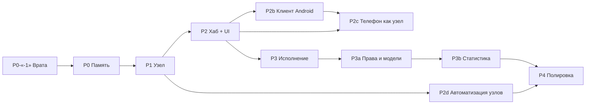

# План: этапы, объём, приёмка

Дата: 2026-11-24 · Статус: P0-«-1», P0, P1, P2, P2b, P2c, P2d, P3 (без approvals) и P3a (прокси и allowlist)
сделано и проверено на живой паре (хаб + debian17 + два телефона); остались approvals-релей, матрица видимости,
агрегаты статистики и P4.

## 1. Что считается готовым

Этап закрыт только вместе с гейтом: без исполняемой проверки этап не считается сделанным. Гейты — это
скрипты и тесты, которые падают, если инвариант нарушен. Не «сервисы живы», а «поведение правильное».

## 2. Этапы

| Этап | Что получаем | Объём | Время | Гейт приёмки | Статус |
| --- | --- | --- | --- | --- | --- |
| **P0-«-1». Врата** | пакет `federation-gate`: 6 инвариантов парами «плохо/хорошо», контрактный чек, канареечный узел | ~400 строк | 2 дня | сумма `usage` в журнале = число вызовов в логе прокси; чек-скрипт возвращает ненулевой код на каждом «плохо» | ✅ 5 инвариантов (`hub/test/gates.test.mjs`); контрактный чек и канарейка — нет |
| **P0. Память** | спул событий узла → `/fed/v1/memory` → **общий RAG** (`dsh-memory-hub` + LightRAG), метка `workspace`/`node`, бэкфилл | ~250 строк | 2 дня | факт из старой сессии узла находится одним `memory_search` и на хабе, и на узле; в индексе не появилось второго RAG | ✅ сделано |
| **P1. Узел** | спаривание, токен, `index/snapshot/usage/memory`, SSE-клиент, адаптер моделей | ~800 строк | 4–5 дней | после `systemctl restart dsh-web` хаб видит узел без ручных шагов; разрыв сети восстанавливается с того же курсора; повторный `commandId` не исполняется дважды | ✅ сделано |
| **P2. Хаб + UI** | SQLite, снапшоты, приём, SSE наружу, панель «список + сессия», панель «Обзор базы Obsidian» | ~1150 строк | 5–6 дней | переписка в UI совпадает с `session.markdown` узла; скрытая сессия отсутствует в списке и отдаёт `404` по прямому id; «Обзор базы» отдаёт заметки по разделам и последний `analysis-*.md` (JSON и `format=svg`), а без vault — `available:false`, не `500` | ✅ сделано |
| **P2b. Клиент Android** | приложение: узлы, сессии, переписка, промпт, approvals; раскладки под сгиб | ~1200 строк | 5–6 дней | на живом телефоне: список узлов, открытие сессии, отправка промпта, подтверждение и отказ; сгиб/разгиб не теряет экран и черновик | ✅ сделано (без экрана подтверждений хода) |
| **P2c. Телефон как узел** | служба устройства: `sandbox` / `assist` / `full`, инструменты `phone_*`, политики, аудит, стоп | ~2000 строк | 3–4 недели | скриншот и тап по элементу воспроизводятся с ПК; в `sandbox` чужой экран не читается; `full` без Shizuku честно деградирует в `assist`; опасный инструмент требует подтверждения | ✅ сделано 24.11: Shizuku, `full`, политики, стоп, аудит |
| **P2d. Автоматизация узлов** | манифест профиля хаба (скиллы, `@local/*`, патчи, MCP, пресеты, чек-скрипты), `automation.apply` по SSE, дрейф, откат, канарейка | ~450 строк | 2–3 дня | чистая машина + `pair` + один `apply` даёт те же скиллы и тот же `sha`, что на хабе, `apply.sh --check` и `check-*.mjs` зелёные; удалённый скилл восстанавливается как `drift`→`in-sync`; несовпадение версии DSH даёт `incompatible` без поломки узла | ✅ сделано |
| **P3. Исполнение** | prompt/cancel/rename, очередь, TTL, approvals-релей, аудит | ~350 строк | 3–4 дня | промпт из UI хаба исполняется на узле (`state=running` там), ответ только в логе узла | ✅ prompt/cancel/rename, очередь, TTL; approvals-релей — нет |
| **P3a. Права и модели** | матрица видимости, allowlist моделей, прокси «единственные ворота», отзыв доступа | ~650 строк | 3–4 дня | смена режима узла применяется ≤5 с; запрос запрещённой модели → `403` + аудит; `fallback` решается на загрузке конфига | ✅ прокси моделей, allowlist, отзыв; матрица видимости — нет |
| **P3b. Статистика** | `usage`, агрегаты 24 ч / 14 дней, карточки, граф памяти | ~350 строк | 2 дня | сумма `usage` по узлу = числу вызовов в логе прокси; расход сходится с провайдерским счётом при `user = hash(token)` | 🟡 `usage` и `llm/stats` есть; агрегаты 24 ч / 14 дней и карточки — нет |
| **P4. Полировка** | второй узел, офлайн-очередь, доки, чек-скрипт | ~200 строк | 2–3 дня | второй узел подключается по той же инструкции; офлайн-команда истекает по TTL с записью в аудит | ⬜ не начато |

MVP — P0–P2 (полторы недели). С телефоном — 7–8 недель агентской работы с тестами на живых устройствах.

## 3. Порядок и зависимости

Правило: телефон не начинаем, пока хаб не отдаёт список сессий; правку модели не начинаем, пока врата не
считают `usage`; автоматизацию не раскатываем на все узлы, пока канареечный узел не прошёл `apply.sh --check`
и `check-*.mjs`.

## 4. Риски

1. **Пересжатие zstd-кадров сессий** — самая дорогая ошибка; только append через API, чекер в таймере.
2. **Чужой лог в `sessions/` хаба** ломает весь список (`assertStoredIdentity`) — поэтому снапшоты, а не
   раскладка чужих файлов.
3. **Двойное исполнение** при реконнекте — идемпотентность `commandId` и дедуп по `id`.
4. **Утечка через память** — фильтр видимости обязателен в поиске, иначе скрытое читается.
5. **Один процесс хаба**: его рестарт рвёт SSE; узлы переподключаются, хаб реплеит из БД.
6. **Контракты между версиями DSH** менялись — пиннинг версии, `proto: 1`, контрактный чек.
7. **Стоимость бэкфилла в граф** — дешёвая модель, кэш, лимит на день.
8. **Телефон как удалённый доступ к личному устройству** — токен, подтверждения, аудит, отзыв, песочница
   по умолчанию.
9. **Раскатка автоматизации — общий рубильник**: один плохой патч или скилл ложит поведение всех узлов
   разом. Поэтому канарейка, staging с атомарной заменой и откатом, гейт по версии DSH — а не «разошлём
   всем и посмотрим».

## 5. Чего сознательно не делаем

- Отдельные аккаунты людей: смотрящий — узел; когда появятся люди, `viewer` станет человеком.
- Песочницы для чужих промптов: исполнение идёт правами владельца сессии — осознанный выбор.
- Внешний LLM-гейтвей (LiteLLM и подобные): свой прокси меньше и не теряет DSH-специфику.
- WebSocket: SSE с курсором закрывает потребность.
- mTLS/JWT на каждый запрос: TLS + bearer + Origin достаточно для домашней федерации.
- Синхронизация логов с хаба обратно на узел: хаб — читатель.
- Свой набор скиллов и зависимостей на узле «как привык»: расхождение — это тихая разница в поведении
  агента, лечим манифестом, а не вкусом устройства.
- Пересылка секретов на узлы: ключи LLM и токены остаются на хабе.
- Раскатка автоматизации на телефон: профиля DSH там нет, обновление — APK.
- Слияние с другими ядрами в один репозиторий.

## English

Every stage closes only with a gate: a runnable check that fails when the invariant breaks. The table above
maps each stage to its gate — for example, the usage gate compares token counts in the session journal with
the proxy request log, and the phone gate proves that `sandbox` mode cannot read foreign screens while `full`
mode honestly degrades to `assist` without Shizuku. Order matters: the phone starts after the hub lists
sessions, model policy after the gates count usage. Volumes are agent-estimates with tests on live devices,
not man-months.

Stage P2d makes automation a hub concern rather than a per-device hobby: skills, plugins, dependencies and
kernel patches are assembled once in the hub profile and rolled out to nodes as a content-addressed manifest
applied through the existing command channel. Its gate is behavioural: a bare machine plus pairing plus one
apply must end up with the same skill set and the same `sha` as the hub, a deleted skill must come back as
`drift`→`in-sync`, and a node on a different DSH version must be refused as `incompatible` while staying
usable on its previous set. Canary first, atomic swap with rollback, no secrets in the manifest, and
`sessions/` is never part of it.
